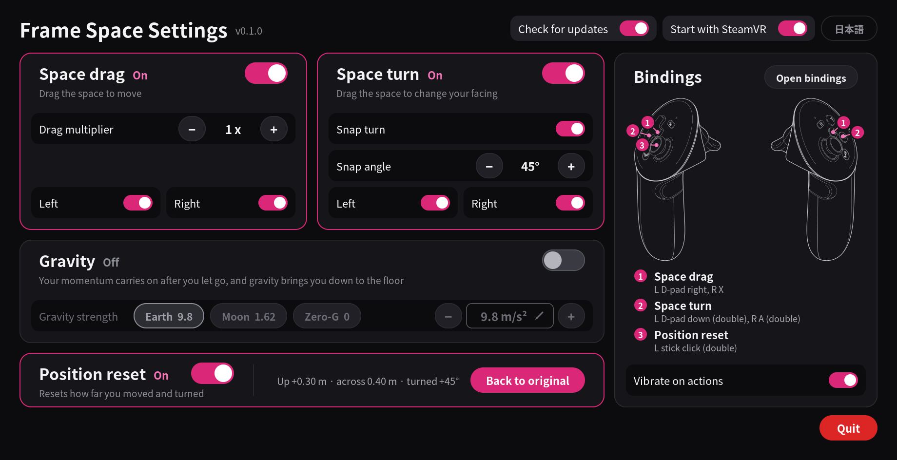

# Frame Space Settings

[日本語](README.md)

Space drag and space turn for the **Steam Frame**, running natively on the headset (Linux ARM64, SteamVR on the Frame).
Grab the space with a controller button to move or turn yourself, like OpenVR Advanced Settings' space drag, with
optional gravity. Settings live in a SteamVR dashboard tab.

This app is vibe coded.



## Features

- **Space drag**: hold the bound button and move your hand to move yourself. Multiplier from 0.25x to 4x, left and
  right hand can be switched off separately.
- **Space turn**: hold the bound button and swing your hand around your head to turn in place. Smooth, or snap turn
  in steps of 5° to 90° with the same gesture. Left and right hand can be switched off separately.
- **Gravity**: after you let go, your momentum carries on and gravity brings you down to the floor. Presets for
  Earth, Moon and zero-G, fine steps with the -/+ buttons, or any value from 0 to 50 m/s² typed on the SteamVR
  keyboard.
- **Position reset**: a controller button (can be turned off) and the "Back to original" button in the panel undo all
  movement and turning.
- **Bindings view**: the panel shows the Steam Frame controllers with every button bound to these features, read live
  from SteamVR's bindings. Changes are made in SteamVR's binding editor ("Open bindings").
- Haptic clicks, Japanese / English UI (follows Steam's language, switchable in the panel), start with SteamVR, quit
  from the panel or by closing the dashboard tab.

## Requirements

- A Steam Frame with SteamOS and SteamVR (everything is done on the Frame itself)

## Install

1. On the Steam Frame, with SteamVR running, open the desktop and start Konsole
2. Run:

   ```sh
   curl -fsSL https://github.com/KRHa0024/FrameSpaceSettings/releases/latest/download/install.sh | bash
   ```

3. Restart SteamVR once (to load the driver)

"Frame Space Settings" appears as a tab in the SteamVR dashboard and starts with SteamVR from then on. No root access
is needed; everything goes into your home directory.

## Updates

20 seconds after start and every 12 hours after that, the app asks GitHub for a newer release and shows a notice at
the bottom of the panel when there is one. If GitHub cannot be reached (offline, for example) nothing is shown and it
tries again at the next check.

"Update" in the notice downloads it, checks its checksum, swaps it in and restarts the app (your movement and turning
are reset). If the driver changed too, the new driver takes effect after a SteamVR restart. Turn the check off with
"Check for updates" in the panel.

Running the install command again also updates to the latest release (it takes over after a SteamVR restart).

## Uninstall

Run `~/.local/bin/frame-space-settings --uninstall` while SteamVR is running, then restart SteamVR. Settings
(`~/.config/frame-space-settings`) and logs (`~/.local/state/frame-space-settings`) are kept.

## Default bindings (Steam Frame controllers)

| Feature | Button |
|---|---|
| Space drag | D-pad right (left hand) or X (right hand): hold, then move your hand |
| Space turn | D-pad down (left hand) or A (right hand): double-press and hold, then swing your hand around your head |
| Position reset | Left thumbstick click: double-press |

Buttons and press types can be changed in SteamVR's binding editor ("Open bindings" in the panel).

## Limitations

- It may interfere with other tools that move the playspace. If so, turn the interfering tool off
- It works by hooking into SteamVR internals, so a SteamVR update may break it

If something goes wrong, turn off `framespacesettings` in SteamVR Settings → Startup / Shutdown → Manage Add-ons.

## License

MIT, see [LICENSE](LICENSE). `third_party/openvr` is Valve's OpenVR SDK header set (BSD 3-Clause, see its
[LICENSE](third_party/openvr/LICENSE)). The controller art shown in the panel is read from the SteamVR install at run
time and is not part of this repository.

Not affiliated with or endorsed by Valve. Steam, Steam Frame and SteamVR are trademarks of Valve Corporation.
