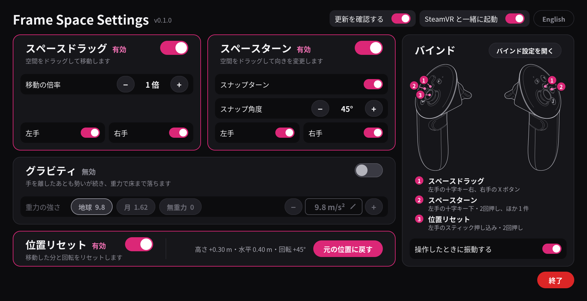

# Frame Space Settings

[English](README.en.md)

**Steam Frame** 向けのスペースドラッグ・スペースターンのツールです。
OpenVR Advanced Settings のスペースドラッグのように、コントローラのボタンで空間をドラッグして移動・回転できます。グラビティ（重力）の設定もあります。設定は SteamVR ダッシュボードのタブで行います。

SteamVR のドライバとして動作するため、Steam Frame が定期的に行うプレイスペースのリセット処理の影響を受けません。移動した位置が勝手に戻ることはありません。

なお、このアプリは Vibe Coded です。



## 機能

- **スペースドラッグ**：割り当てたボタンを押したまま手を動かすと移動します。移動の倍率（0.25〜4 倍）と、左右の手ごとの有効・無効を設定できます。
  「軸の固定」で X・Y・Z の移動を個別に止められます（例：X と Z を固定すると上下だけ動きます）。Y は常に上下、X と Z はボタンを押したときの顔の向きを基準にした左右と前後です。
- **スペースターン**：割り当てたボタンを押したまま頭の周りで手を回すと、その場で向きを変えます。なめらかに回すか、同じ操作のまま一定の角度（5〜90°）ずつ回すスナップターンかを選べます。左右の手ごとの有効・無効も設定できます。
- **グラビティ**：ボタンを離したあとも勢いが続き、重力で床まで落ちます。重力の強さは、地球・月・無重力のプリセット、−/＋ボタンでの微調整、SteamVR のキーボードでの数値入力（0〜50 m/s²）で設定できます。
- **位置リセット**：コントローラのボタン（無効にもできます）か、パネルの「元の位置に戻す」ボタンで、移動と回転をすべて元に戻します。
- **バインドの表示**：Steam Frame コントローラの絵に、各機能が割り当てられたボタンを表示します。内容は SteamVR のバインドから直接読み取ります。変更は SteamVR のバインド設定で行います（「バインド設定を開く」）。
- **そのほか**：操作時の振動、日本語・英語の表示（Steam の言語設定に合わせ、パネルで切り替えも可能）、SteamVR と一緒に起動、パネルの「終了」ボタンやダッシュボードのタブを閉じる操作での終了に対応しています。

## 必要なもの

- SteamOS と SteamVR が入った Steam Frame（インストールから操作まで、すべて Frame の中で行います）

## インストール

1. Steam Frame で SteamVR が動いている状態で、デスクトップを開いて Konsole を起動する
2. 次のコマンドを実行する

   ```sh
   curl -fsSL https://github.com/KRHa0024/FrameSpaceSettings/releases/latest/download/install.sh | bash
   ```

3. SteamVR を一度再起動する（ドライバを読み込むため）

SteamVR のダッシュボードに「Frame Space Settings」のタブが追加され、以降は SteamVR と一緒に起動します。root 権限は必要ありません。ファイルはすべてホームディレクトリの中に置きます。
ダッシュボードの「＋」ボタンの一覧にも追加されます。ここから起動でき、常駐中に選ぶとパネルが開きます。

## 更新

起動の 20 秒後と、その後 12 時間ごとに GitHub で新しいバージョンを確認し、見つかるとパネルの下部にお知らせが表示されます。オフラインなどで確認できなかったときは何も表示せず、次の確認を待ちます。

お知らせの「更新する」を押すと、ダウンロード、チェックサムの確認、入れ替えまでを自動で行い、アプリが再起動します（移動と回転はリセットされます）。ドライバも更新された場合は、SteamVR を再起動すると新しいドライバが有効になります。確認はパネルの「更新を確認する」でオフにできます。

インストールのコマンドをもう一度実行しても最新版に更新できます（SteamVR を再起動すると新しいバージョンに切り替わります）。

## アンインストール

SteamVR が動いている状態で `~/.local/bin/frame-space-settings --uninstall` を実行し、SteamVR を再起動してください。設定（`~/.config/frame-space-settings`）とログ（`~/.local/state/frame-space-settings`）は残ります。

## 既定のバインド（Steam Frame コントローラ）

| 機能 | ボタン |
|---|---|
| スペースドラッグ | 左手は十字キー右、右手は X ボタンを押し続け、手を動かす |
| スペースターン | 左手は十字キー下、右手は A ボタンを2回押して押し続け、頭の周りで手を回す |
| 位置リセット | 左手のスティック押し込みを2回押し |

ボタンや押し方は、SteamVR のバインド設定（パネルの「バインド設定を開く」）で変更できます。

## 制限

- プレイスペースを動かすほかのツールと干渉する場合があります。そのときは、干渉しているツールを無効にするなどして対処してください
- SteamVR の内部の処理に割り込んで動作するため、SteamVR の更新で動かなくなることがあります

動作がおかしいときは、SteamVR の設定 → スタートアップ/シャットダウン → アドオンの管理で `framespacesettings` をオフにしてください。

## ライセンス

MIT です（[LICENSE](LICENSE)）。`third_party/openvr` は Valve の OpenVR SDK のヘッダで、BSD 3-Clause です（[LICENSE](third_party/openvr/LICENSE)）。パネルに表示するコントローラの絵は、実行時に SteamVR のファイルから読み込むもので、このリポジトリには含めていません。

Valve とは関係のない非公式のツールです。Steam、Steam Frame、SteamVR は Valve Corporation の商標です。
